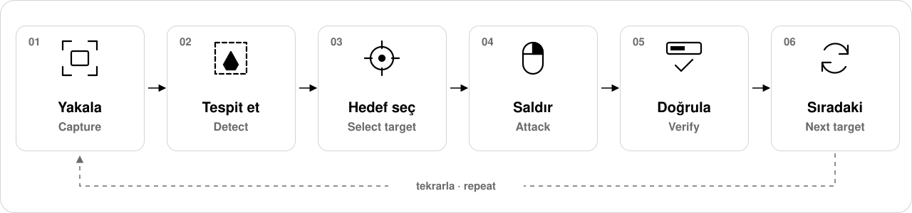
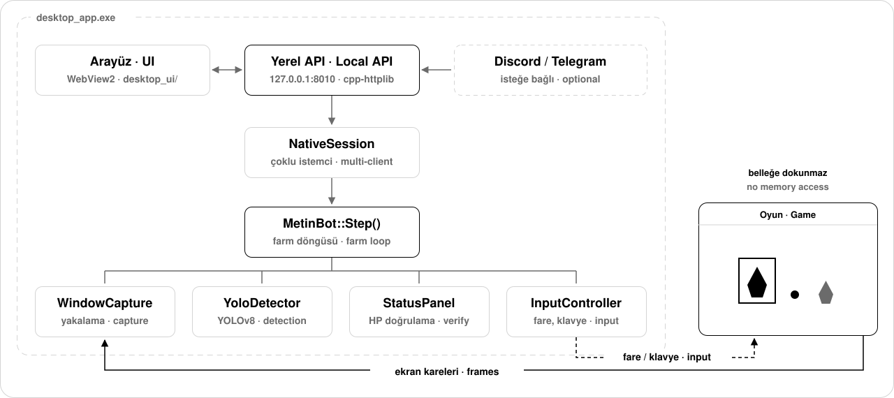

<div align="center">

<picture>
  <source media="(prefers-color-scheme: dark)" srcset="docs/img/banner-dark.svg">
  
</picture>

# Elbit · Metin2 Farm Bot

**Açık kaynak Metin2 farm botu** · **Open source Metin2 farm bot**

[Türkçe](#türkçe) · [English](#english) · [Nasıl çalışır / How it works](#nasıl-çalışır--how-it-works) · [Derleme / Build](#derleme--build)

</div>

## Türkçe

**Elbit**, Metin2 için C++ ile yazılmış açık kaynak bir **Metin2 farm botu** ve
**metin botu**dur. Metin taşlarını YOLOv8 ve OpenCV ile ekranda bulur, hedefe
kilitlenir, keser ve sıradaki metine geçer.

- **Görüntü tabanlı:** Oyun belleğini okumaz, koda enjekte olmaz. Yalnızca ekran görüntüsü ve Win32 girdisi kullanır.
- **Metin farm döngüsü:** Tespit, hedef seçimi, saldırı, HP barıyla doğrulama, kamera ile arama ve takılma önleme.
- **Çoklu istemci:** Birden fazla oyun penceresini sırayla farmlar.
- **Masaüstü arayüzü:** WebView2 paneli, zamanlayıcı ve isteğe bağlı Discord / Telegram ile uzaktan kontrol.

## English

**Elbit** is an open source **Metin2 bot** and **Metin2 farm bot** written in
C++. It finds Metin stones on screen with YOLOv8 and OpenCV, locks on, farms
them and moves on to the next one.

- **Vision based:** No memory reading, no injection. Only screen capture and Win32 input.
- **Metin farm loop:** Detection, target selection, attack, HP bar verification, camera search and anti-stuck recovery.
- **Multi-client:** Farms several game windows in turn.
- **Desktop app:** WebView2 panel, scheduler and optional Discord / Telegram remote control.

> [!WARNING]
> Oyun otomasyonu çoğu sunucunun kullanım koşullarına aykırıdır ve hesabınızın
> kapatılmasına yol açabilir. Kod eğitim ve araştırma amaçlı paylaşılmıştır.
> Bu sürümde bot kontrol / bulmaca doğrulama ekranlarını çözen modüller **yoktur**.
>
> Game automation violates the terms of service of most servers and may get your
> account banned. This code is shared for educational and research purposes.
> Modules that solve anti-bot / captcha checks are **not** included.

## Nasıl çalışır / How it works

<picture>
  <source media="(prefers-color-scheme: dark)" srcset="docs/img/pipeline-dark.svg">
  
</picture>

## Mimari / Architecture

<picture>
  <source media="(prefers-color-scheme: dark)" srcset="docs/img/architecture-dark.svg">
  
</picture>

Ayrıntılı tasarım notları / Detailed design notes (TR): **[docs/MIMARI.md](docs/MIMARI.md)**

<details>
<summary><b>Modüller ve dosyalar · Modules and files</b></summary>

| Modül | Dosya | Ne yapar |
|---|---|---|
| Pencere yakalama | `src/capture.*` | Windows Graphics Capture ile pencere odakta olmasa bile kare alır |
| Pencere yardımcıları | `src/win_window.*` | Pencere bulma, ön plana getirme, istemci alanı ↔ ekran koordinatı |
| YOLO tespit | `src/yolo_detector.*` | ONNX Runtime ile YOLOv8 modellerini çalıştırır (letterbox, NMS) |
| Şablon tespiti | `src/template_detector.*`, `src/orb_detector.*` | Çok ölçekli şablon eşleştirme ve ORB öznitelik eşleştirme |
| Renk tespiti | `src/color_detector.*`, `src/auto_color_detector.*` | HSV aralığı / şablondan otomatik renk profili çıkarma |
| İsim etiketi | `src/name_label_detector.*` | Nesnenin üstündeki isim yazısını açıdan bağımsız bulma |
| Durum paneli | `src/status_panel_detector.*` | Hedef kilitlendi mi: HP barı / isim paneli doğrulaması |
| Girdi | `src/input.*` | `SetCursorPos` + `SendMessage` + scancode'lu `SendInput`, kamera döndürme |
| Bot mantığı | `src/bot.*` | Farm alanı, hedef kilitleme, kuyruk, arama, takılma önleme, loot |
| Kalibrasyon | `src/calibration.*` | Ekranı tıklamadan izleyip eşikleri o cihaza göre önerir |
| Masaüstü uygulaması | `src/desktop_app_main.cpp`, `desktop_ui/` | WebView2 penceresi + `127.0.0.1:8010` yerel API |
| Uzaktan kontrol (isteğe bağlı) | `src/discord_bot.*`, `src/telegram_bot.*` | Kendi bot token'ınızla durum sorgulama / başlat-durdur |

</details>

## Gereksinimler / Requirements

- Windows 10/11 (x64)
- Visual Studio 2022 veya daha yenisi, **"Desktop development with C++"** iş yükü
  (CMake ve vcpkg bu iş yüküyle gelir)
- [Git LFS](https://git-lfs.com/): YOLO modelleri (`models/*.onnx`) LFS ile saklanır
- Microsoft Edge WebView2 Runtime (Windows 11'de hazır gelir)

## Derleme / Build

```powershell
git lfs install
git clone https://github.com/wakopik/metin2-farm-bot.git
cd metin2-farm-bot

# "x64 Native Tools Command Prompt for VS" içinde:
set VCPKG_ROOT=C:\Program Files\Microsoft Visual Studio\18\Community\VC\vcpkg
cmake --preset default
cmake --build --preset default
```

`CMakePresets.json` içindeki generator `Visual Studio 18 2026`'dır. Farklı bir
sürüm kullanıyorsanız generator'ı değiştirin ya da Visual Studio'da
**File → Open → Folder** ile klasörü açın. Visual Studio CMake'i ve vcpkg'yi
kendisi çalıştırır. İlk derlemede OpenCV ve ONNX Runtime derlendiği için
uzun sürebilir.

Çıktılar `build/Release/` altına gelir. `config.json`, modeller, şablon
klasörleri ve `onnxruntime.dll` derleme sonrası exe'nin yanına otomatik
kopyalanır.

| Hedef | Açıklama |
|---|---|
| `desktop_app` | Ana uygulama (arayüzlü). Yönetici olarak çalışır |
| `metin2_farm_bot` | Arayüzsüz konsol motoru (L = başlat, K = duraklat, ESC = çıkış) |
| `debug_preview` | Tespitleri canlı gösterir, **tıklamaz**. Model/eşik ayarı için |
| `template_picker` | Şablon ve eğitim verisi (ekran görüntüsü) toplama aracı |
| `color_picker` | HSV renk profili toplama aracı |

## Klasör yapısı / Project layout

```
metin2-farm-bot/
  CMakeLists.txt, CMakePresets.json, vcpkg.json
  config.json            tüm ayarlar (yorumlar src/config.h içinde)
  src/                   C++ kaynakları
  desktop_ui/            WebView2 arayüzü (HTML/CSS/JS, i18n: TR/EN)
  assets/                uygulama simgesi
  models/                YOLO modelleri (Git LFS): dovus, savas, golge, ...
  dovus/ savas/ golge/ kiskanclik/ karanlik/ ruh/ dayaniklilik/
                         metin türü başına şablonlar (_name.png, _panel.png)
  hp_bar/                HP barı referans görüntüsü
  nesne_market/          kapatılacak bildirim şeridi şablonu
  eldiven/               envanter eşyası şablonu
  docs/MIMARI.md         mimari ve tasarım notları
  docs/img/              README görselleri (açık/koyu SVG) ve sosyal önizleme
```

Kök dizindeki bir klasörün içinde `.png` varsa arayüz onu seçilebilir bir
metin türü olarak listeler (bkz. `ScanMetinFoldersNative`). Altyapı
klasörleri `kSkipFolders` ile bu listeden hariç tutulur.

## Ayarlar / Configuration

Bütün ayarlar `config.json` içindedir. Her alanın açıklaması ve ölçüme dayalı
gerekçesi `src/config.h` içinde yorum olarak durur. Değişiklik için yeniden
derlemek gerekmez, uygulamayı yeniden başlatmak yeterli.

| Alan | Anlamı |
|---|---|
| `window_title_hint` | Oyun penceresi başlığında aranan metin |
| `yolo_models` | Kategori → `.onnx` yolu, isteğe bağlı `conf_threshold` / `class_index` |
| `yolo_input_size`, `yolo_conf_threshold`, `yolo_nms_threshold` | YOLO çıkarım ayarları |
| `templates_dirs` | İsim etiketi / panel şablonlarının okunduğu klasörler |
| `farm_zone_radius_x_ratio` / `_y_ratio` | Karakter etrafındaki elips farm alanı (kare boyutuna oranla) |
| `click_burst_count`, `max_target_wait_sec` | Hedef başına tıklama sayısı / en uzun bekleme |
| `camera_rotate_*`, `search_action_wait_sec_*` | Hedef yokken arama davranışı |
| `discord_*`, `telegram_bot_token` | İsteğe bağlı uzaktan kontrol. Boşsa kapalıdır |

> Discord / Telegram token'larınızı `config.json`'a yazdıysanız o dosyayı
> **commit etmeyin.** `git update-index --skip-worktree config.json` ile yerel
> değişikliklerinizi Git'ten gizleyebilirsiniz.

## Kendi modelinizi eğitmek / Training your own model

`models/` altındaki modeller Ultralytics YOLOv8 ile eğitilip ONNX'e aktarılmış
tek sınıflı modellerdir. Yeni bir metin türü eklemek için:

1. `template_picker` ile oyundan ekran görüntüleri toplayın.
2. Görüntüleri etiketleyin (ör. Roboflow / Label Studio) ve YOLOv8 ile eğitin.
3. `yolo export model=best.pt format=onnx imgsz=800` ile dışa aktarın.
4. `.onnx` dosyasını `models/` altına koyup `config.json` → `yolo_models`
   listesine ekleyin.
5. `debug_preview` ile tıklama yapmadan tespitleri doğrulayın.

## Bu sürümde olmayanlar / Not included in this release

Orijinal projede bulunan şu kısımlar açık kaynak sürüme **alınmadı**:

- Bot kontrol / bulmaca doğrulama ekranlarını otomatik çözen modüller ve
  bunların test araçları, örnek görselleri
- Lisans sunucusu istemcisi, cihaz kilidi (HWID), oturum bekçisi
- Anti-debug / sanal makine tespiti / string gizleme (obfuscation),
  gizli başlatıcı ve otomatik güncelleyici
- Interception sürücüsü kurulum/tanı araçları (girdi artık yalnızca Win32 API ile yapılır)
- Paketleme betikleri ve dağıtım çıktıları

## Lisans / License

[MIT](LICENSE) © wakopik

Arayüz fontu Plus Jakarta Sans, [SIL OFL 1.1](desktop_ui/fonts/OFL.txt) ile dağıtılır. / The UI font is licensed under SIL OFL 1.1.
